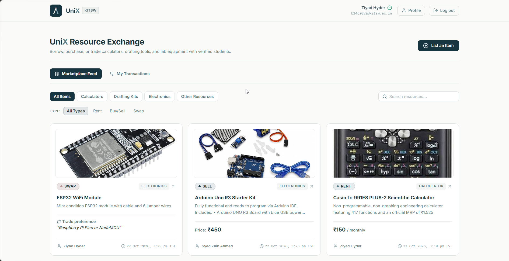
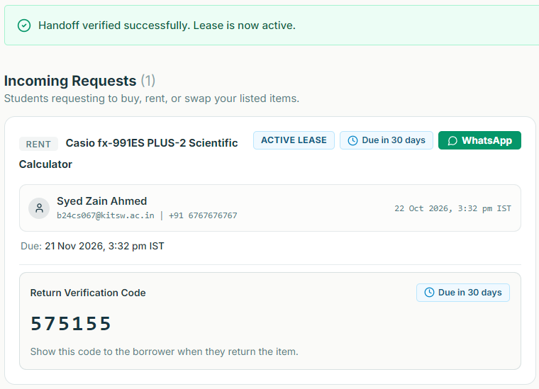
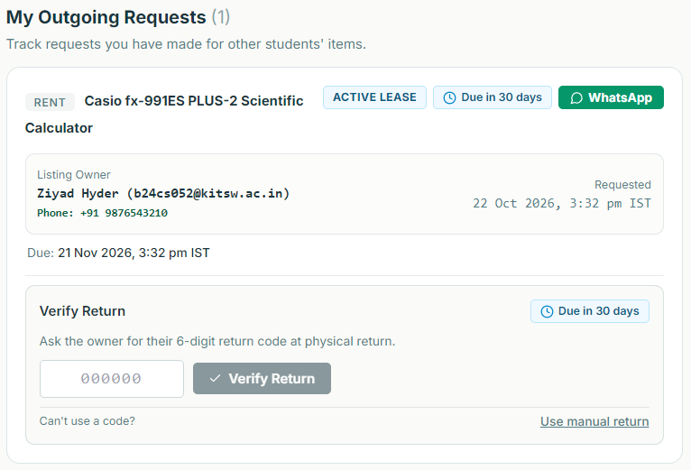
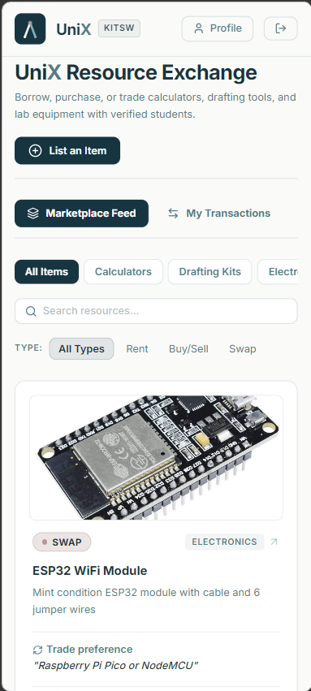

# UniX

Campus marketplace for KITSW students to rent, buy or swap calculators, drafting kits and lab equipment. Access is limited to verified `@kitsw.ac.in` accounts.

**Live: [unix.ziyadhyder.dev](https://unix.ziyadhyder.dev)**



<p>
  
  
  
</p>

---

## Overview

Engineering students buy calculators, drafting kits and lab components that go unused after a semester or two. UniX lets verified students list these items for rent, sale or swap. Rentals are tracked from request to return: possession is confirmed with codes, a scheduler enforces due dates, and late returns have defined consequences.

---

## Rentals

Each rental moves through a 9-state machine: `PENDING`, `ACCEPTED`, `ACTIVE_LEASE`, `OVERDUE`, `RETURN_PENDING`, `COMPLETED`, `REJECTED`, `CANCELLED` and `EXPIRED`. The backend rejects invalid transitions. A background scheduler marks overdue leases, sends email reminders and expires stale requests.

```
PENDING -> ACCEPTED -(handoff code)-> ACTIVE_LEASE -(return code)-> COMPLETED
                                          |
                                          v
                                       OVERDUE -(return code)-> COMPLETED
```

### Handoff and return codes

Neither party can change a rental's state alone. Mutual 6-digit codes confirm possession at pickup and drop-off. The borrower shows a handoff code to the owner at pickup, and the owner shows a return code to the borrower at drop-off.

Codes are derived with HMAC-SHA256 from a server secret and the transaction id, so none are stored. Comparison is constant-time, and repeated failures trigger a temporary lockout. A "Can't use a code?" fallback covers dead phones, and each lease records which method started it (`CODE`, `BORROWER_CONFIRM` or `AUTO`).

### Late-return penalties

An overdue lease freezes the borrower's account only if both parties confirmed the lease. Leases that started automatically after an owner's unilateral handoff are excluded. A freeze blocks new requests. Login, returns and owner actions keep working.

### Contact reveal

WhatsApp numbers never appear on listings. They are revealed to both parties only while a transaction is in an active state, and hidden again when it ends.

### Push notifications

Real-time push notifications alert students to request updates, lease reminders, and return deadlines even when the browser is closed. Subscriptions are managed per device and can be toggled from the user profile.

---

## Technical challenges

### Cross-site auth on iOS Safari

The frontend (Cloudflare Pages) and the API are on different domains. Even with `SameSite=None; Secure`, WebKit's tracking prevention blocks the session cookie. The API now also returns the JWT in the login response body, and an Axios interceptor sends it as `Authorization: Bearer`. The backend checks the header first and falls back to the cookie.

### Memory limits on a 1 GB VM

The API runs on Oracle's free tier, which required strict memory tuning to prevent OOM faults. Heap, metaspace, code cache and thread stacks are capped, the JVM uses the serial GC, and a swapfile acts as a last-resort buffer. An 80 MB metaspace cap crashed the app at startup, since Hibernate, Tomcat and Spring load far more classes during boot than at idle. 128 MB fixed it. A small Python watchdog (30 MB cap) monitors RAM, CPU, swap and OOM kills and sends Telegram alerts with recent logs.

### Concurrent accepts

Two students can accept the same listing at the same moment. Optimistic locking on the listing lets exactly one request win.

### Image uploads

Photos are compressed client-side on a canvas, then uploaded to Cloudflare R2 through the S3-compatible API. Images never touch the database.

### PWA installation and edge deploy cache-busting

UniX runs as an installable Progressive Web App (PWA) with a standalone app shell. Handling installation across mobile ecosystems required two distinct paths:
- On Chromium browsers (Android, Chrome, Edge), the app captures `beforeinstallprompt` and renders an install card triggering the native prompt.
- On iOS Safari (WebKit), where `beforeinstallprompt` is not supported, the banner automatically detects the platform and provides concise inline guidance ("Tap Share, then 'Add to Home Screen'").

To prevent students from holding stale caches after deployments, the Service Worker keys its Workbox `cacheId` and runtime cache names directly to the Cloudflare Pages commit SHA (`CF_PAGES_COMMIT_SHA`). Deployments automatically invalidate and prune obsolete caches on activation without manual version bumps. API requests use a `NetworkFirst` strategy (5-second timeout) so marketplace availability and transaction statuses remain strictly current.

### Schema migrations

Flyway versioned migrations run at startup, so production schema changes are applied the same way as local ones.

---

## Stack

| Part | Technology |
| :--- | :--- |
| Frontend | React 18, Vite 5, React Router 6, Axios, Tailwind CSS 3, Lucide icons, Inter, Vite PWA (Workbox 7) |
| Backend (private repo) | Spring Boot 3, Java 21, Spring Security 6, JPA/Hibernate, Flyway |
| Data and storage | Oracle Autonomous Database 19c (mTLS), Cloudflare R2 |
| Hosting | Cloudflare Pages (frontend), Oracle Cloud free VM with Nginx, systemd and Let's Encrypt (API) |
| Push notifications | Web Push API, Service Worker push events |
| Email | Gmail SMTP for OTPs and due-date reminders |

---

## Frontend

Lease cards show a live countdown and switch to overdue styling when time runs out. A transaction renders different actions and codes depending on whether the viewer is the owner or the borrower. Tested on iOS Safari and Android Chrome.

UniX is fully installable as a standalone PWA on mobile and desktop devices. A smart, non-intrusive install banner detects current display mode, hides permanently if already running standalone, respects session dismissals (`sessionStorage`), and unmounts immediately upon installation.

Styling uses a custom palette called Inception: `#173541` (primary), `#557C86` (slate), `#FAFAF8` (canvas). Inter for text, monospace for verification codes. 39 unit tests cover time formatting, countdown calculations, PWA standalone detection, platform-specific install rules, and push notification utilities (`npm test`).

### Brand identity

The UniX mark is called "The Instrument". It is an engineering drafting compass reduced to its two legs and a central pivot. It references equipment every engineering student recognizes, so it avoids generic e-commerce icons and fintech exchange arrows.

The pivot has two readings: a single origin splitting into two paths (the point of exchange), and one campus supplying different tools to its members. The Inception palette above is part of the same identity. Brand assets (SVG marks, logo lockups, apple touch icons, favicons) are in `public/` and `src/assets/`.

---

## Run locally

Requires Node.js 18+ and npm 9+.

```bash
npm install
echo "VITE_API_URL=http://localhost:8080" > .env.local
npm run dev
```

Open `http://localhost:5173`. `VITE_API_URL` is the only client-side variable. The backend is in a private repo, so a local run needs an API at that URL. Production build: `npm run build` (output in `dist/`). Run tests: `npm test`.

---

## Lessons learned

1. An Axios instance without a `baseURL` calls the static host's own domain and returns confusing `405` errors. Set `VITE_API_URL` explicitly.
2. `SameSite=None; Secure` is insufficient on mobile WebKit. Cross-site sessions need a second path such as a bearer header.
3. `-Xmx` caps only the heap. Metaspace, thread stacks and the JIT cache sit outside it and add up on a small VM.
4. A penalty clock started by one party's unilateral action causes disputes. Requiring confirmation from both sides, with a fallback, was simpler than adding more buttons.
5. PWA installation behaves differently across mobile browsers. Chromium supports programmatic prompts, but iOS Safari requires inline manual instructions. Using `sessionStorage` instead of `localStorage` allows dismissals without permanently suppressing installation for interested users.
6. Web push subscriptions are tied to individual browsers, not accounts. Supporting multiple endpoints per user and automatically pruning stale subscriptions on HTTP 410 (Gone) keeps notification delivery reliable across devices.

---

## Author

Built by [Ziyad Hyder](https://ziyadhyder.dev) (CSE, KITS Warangal), creator of [KITS One](https://ziyadhyder.dev/kits-one).

UniX is an independent student project and is not affiliated with KITS Administration. The backend is in a private repo; walkthroughs available on request.

All rights reserved.